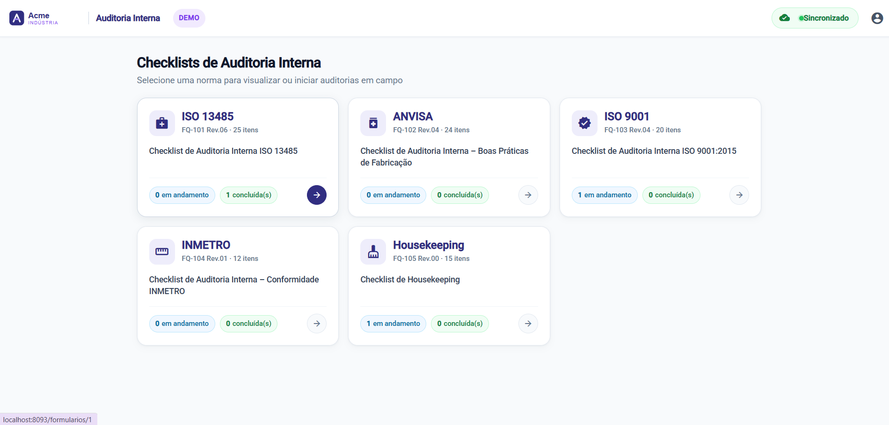
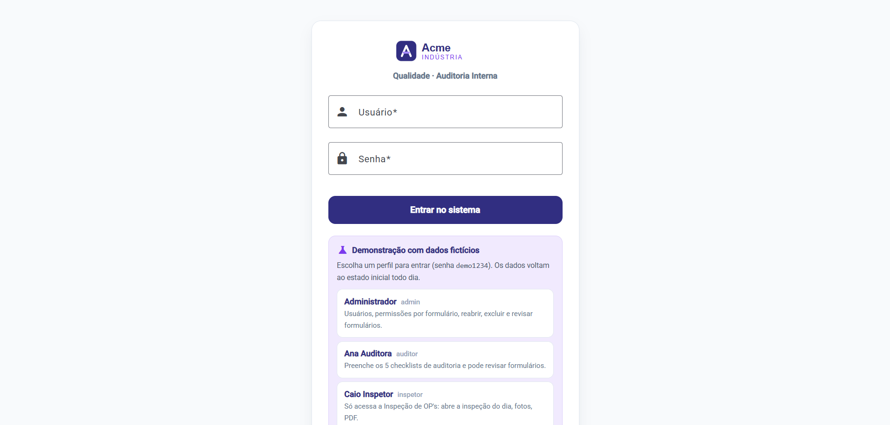
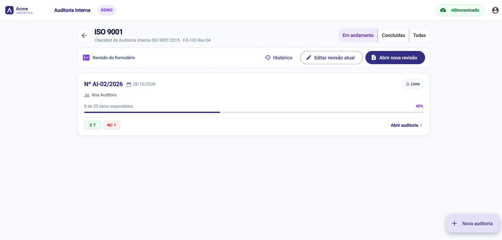
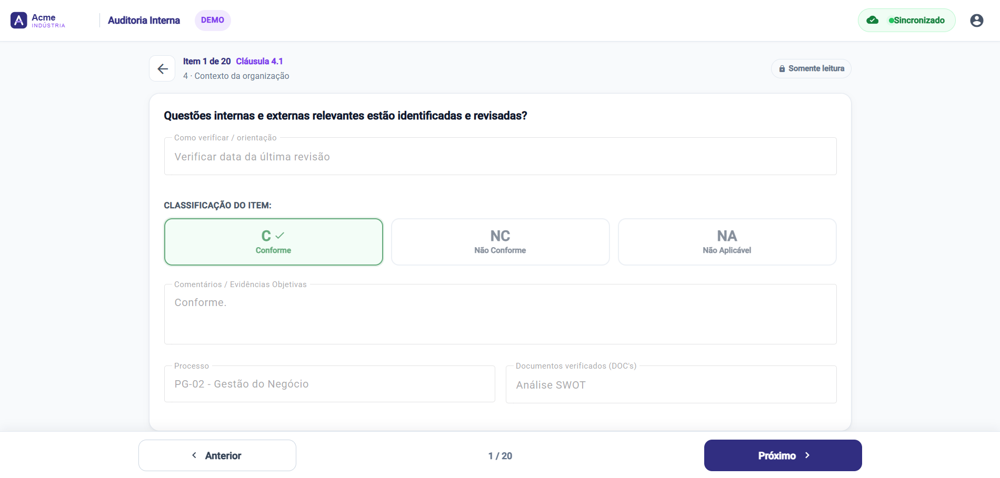
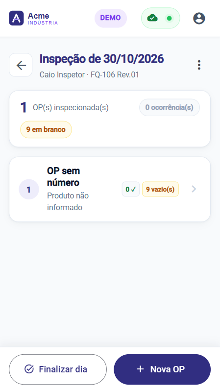
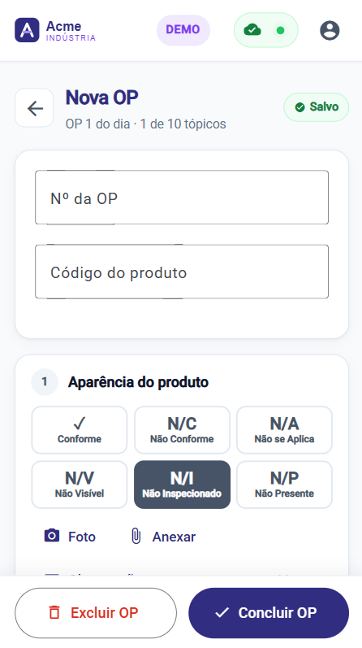
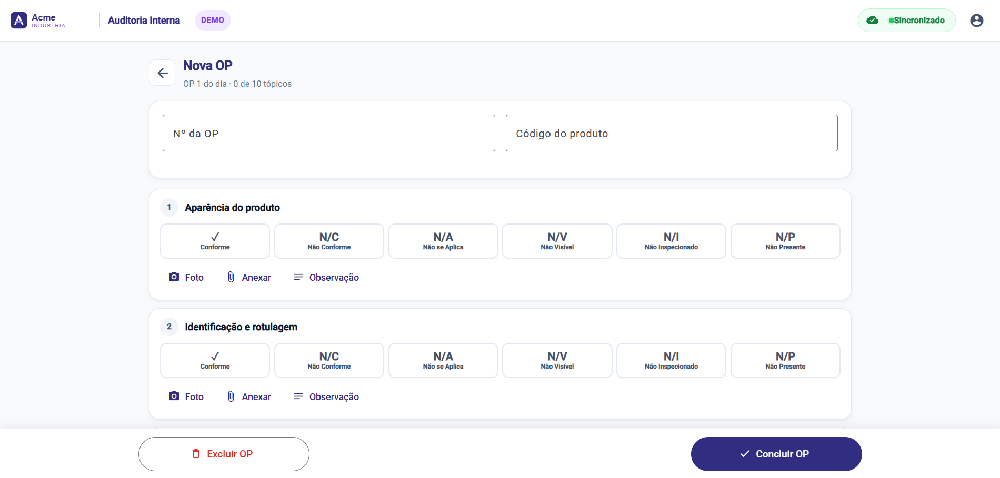
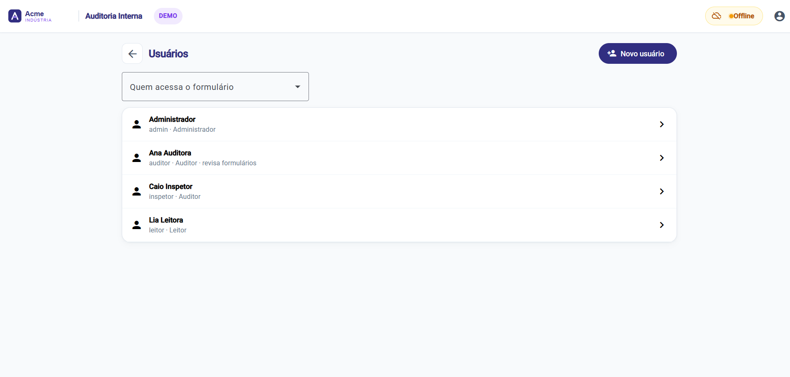
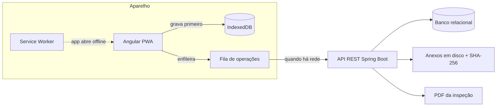

# Checklist de Auditoria

   

Aplicativo web para **auditoria interna e inspeção de produção no chão de fábrica**. O inspetor preenche no celular ou tablet enquanto percorre a fábrica, **mesmo sem rede**, anexa fotos como evidência e tudo sincroniza sozinho quando a conexão volta.

**Live demo:** _link após publicar_

> Esta é uma **versão de demonstração**. A empresa (Acme Indústria), os formulários, as perguntas, as pessoas e os registros são fictícios. O sistema original foi desenvolvido para uso interno de uma indústria e não é público; esta versão mantém o código, a arquitetura e as regras de negócio com dados inventados.



## O problema

As auditorias eram feitas em planilhas, em papel ou Excel, com as fotos de evidência guardadas à parte e sem registro de quem alterou o quê. O preenchimento acontece andando pela fábrica, onde a rede nem sempre alcança.

## A solução

- **Offline-first:** cada resposta é gravada primeiro no aparelho e enviada depois, numa fila que sobrevive a quedas de rede e ao fechamento do navegador.
- **Um formulário configurável por norma:** ISO 13485, boas práticas da ANVISA, ISO 9001, INMETRO, Housekeeping e inspeção diária de ordens de produção, cada um com a própria escala de resposta, colunas e rodapé de impressão.
- **Rastreabilidade completa:** trilha imutável de cada campo alterado, anexos com hash SHA-256 e exclusão sempre lógica.
- **Saída no formato de papel:** impressão em A4 com as fotos de cada item e o PDF diário das inspeções.

## Experimente

Na tela de login, clique em um dos perfis. A senha de todos é `demo1234`.

| Perfil | Login | O que dá para fazer |
|---|---|---|
| Administrador | `admin` | gerenciar usuários e o acesso de cada um por formulário, reabrir e excluir registros, revisar formulários |
| Auditora | `auditor` | preencher os 5 checklists de auditoria, concluir, revisar formulários |
| Inspetor | `inspetor` | abrir a inspeção do dia, lançar OPs, tirar fotos, gerar o PDF |
| Leitor | `leitor` | consultar tudo em modo somente leitura |

A demo já vem com uma auditoria concluída, duas em andamento e uma inspeção finalizada. Os dados voltam ao estado inicial todo dia às 04:00. As contas de exemplo não podem ter senha, papel ou permissões alterados; para testar isso, crie um usuário novo como admin.

| Login com perfis de demonstração | Auditorias de um formulário |
|---|---|
|  |  |



Inspeção de ordens de produção, pensada para o celular:

| Inspeção do dia | Tópicos de uma OP | Mesma tela no desktop |
|---|---|---|
|  |  |  |

Sem rede o app continua funcionando e a pílula de status avisa:



Roteiro sugerido de 3 minutos:

1. Entre como **auditora**, abra a auditoria ISO 9001 em andamento e responda alguns itens.
2. Desligue a rede (modo avião ou DevTools › Offline), continue respondendo e veja a pílula de status ficar "offline". Religue: a fila sobe sozinha.
3. Pressione Ctrl+P na auditoria ISO 13485 concluída para ver a versão de impressão.
4. Entre como **inspetor** e baixe o PDF da inspeção de ontem.

## Decisões técnicas

| Desafio | Solução |
|---|---|
| Trabalhar horas sem rede | Dexie (IndexedDB) guarda as auditorias e uma fila de operações. Edições seguidas no mesmo item viram uma operação só (`chave` + `rev`); o envio só apaga a operação se ela não mudou durante o envio. Erro de rede ou 5xx tenta de novo depois; 4xx fica marcado como recusado para o usuário decidir. |
| Dois inspetores no mesmo formulário | **Check-out exclusivo** por usuário *e* aparelho (header `X-Dispositivo`). Quem não tem o check-out vê em modo leitura (HTTP 423). Sem merge de edições: foi decisão de negócio, mais simples de auditar. |
| Criar registros offline sem conflito | Os ids das inspeções, OPs e fotos nascem no aparelho (UUID). O reenvio é idempotente e o servidor aceita o mesmo id quantas vezes vier. |
| Mudar um formulário com auditorias em curso | Revisão pelo próprio app. Auditorias em andamento recebem a nova versão: pergunta alterada volta a pendente, pergunta removida sai da lista mas a resposta fica guardada. Auditorias concluídas ficam congeladas na revisão em que foram feitas. Dois revisores salvando juntos: `SELECT … FOR UPDATE` + número de versão (HTTP 409). |
| Envio atrasado sobre texto antigo | O aparelho manda o texto da pergunta que exibiu; se a pergunta mudou nesse meio-tempo, a resposta é guardada mas não vale. |
| Segurança | Token opaco (o banco guarda só o SHA-256), revogado ao trocar senha ou papel; limite de tentativas de login; permissão por formulário conferida em toda rota; whitelist de extensões e `nosniff` nos anexos; CSP e demais cabeçalhos. |

## Arquitetura



Um único jar serve a API e o front-end compilado. O schema é versionado com Flyway em SQL portável: a demo usa H2 em memória, e o perfil `prod` usa PostgreSQL.

## Stack

| Camada | Tecnologias |
|---|---|
| Back-end | Java 21, Spring Boot 4 (Spring Security, Spring Data JPA / Hibernate 7), Flyway, openhtmltopdf |
| Front-end | Angular 21 (standalone, zoneless, signals), Angular Material, Service Worker, Dexie 4 |
| Banco | H2 (demo) · PostgreSQL (perfil `prod`) |
| Testes | JUnit + MockMvc: 31 testes de integração (check-out, revisão de formulário, inspeção, permissões, segurança, modo demo) |
| Entrega | jar único · Dockerfile de 3 estágios · blueprint do Render |

## Rodando localmente

Pré-requisitos: Java 21 e Node 24.

```bash
cd frontend && npm ci && npx ng build && cd ..
cd backend && ./mvnw package && cd ..
java -jar backend/target/checklist-auditoria.jar --spring.profiles.active=demo
```

Abra `http://localhost:8080`.

Com Docker:

```bash
docker build -t checklist-auditoria .
docker run -p 8080:8080 checklist-auditoria
```

Desenvolvimento com recarga automática do front (porta 4200, com proxy de `/api` para a 8080):

```bash
cd backend && ./mvnw spring-boot:run -Dspring-boot.run.profiles=demo
cd frontend && npx ng serve
```

Testes do back-end:

```bash
cd backend && ./mvnw test
```

### Configuração

| Variável | Padrão | Uso |
|---|---|---|
| `SPRING_PROFILES_ACTIVE` | `demo` na imagem Docker | `demo` (H2 em memória + contas de exemplo) ou `prod` (PostgreSQL) |
| `DEMO_SENHA` | `demo1234` | senha das contas de exemplo |
| `DEMO_RESET_CRON` | `0 0 4 * * *` | quando a demo volta ao estado inicial (fuso America/Sao_Paulo) |
| `ANEXO_MAX` | `8MB` | tamanho máximo de anexo na demo |

O `render.yaml` publica a demo no [Render](https://render.com) (New › Blueprint). No plano gratuito o serviço dorme após 15 minutos sem acesso; a primeira visita depois disso leva cerca de 1 minuto.

## Estrutura

```
backend/src/main/java/dev/mansano/auditoria/
  auditoria/   auditorias, itens, check-out, conclusão
  anexo/       upload, armazenamento, SHA-256, download
  inspecao/    inspeção de OPs e PDF
  template/    formulários, perguntas e revisões
  permissao/   acesso por formulário
  historico/   trilha de alterações
  usuario/     usuários, login, papéis
  seguranca/   token, filtro de autenticação, limite de login
  demo/        contas de exemplo, dados prontos, reset diário
backend/src/main/resources/db/migration/   schema e formulários de exemplo (Flyway)
frontend/src/app/core/      IndexedDB, filas de sincronização, autenticação, rede
frontend/src/app/paginas/   telas
```
